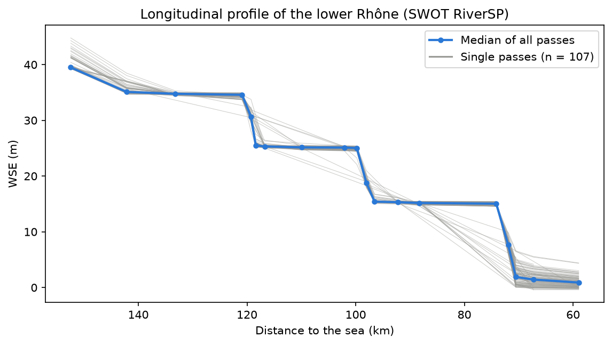
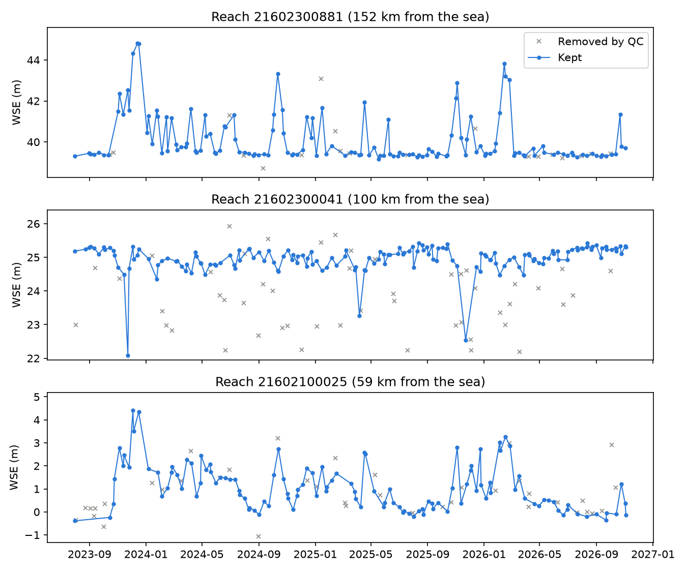
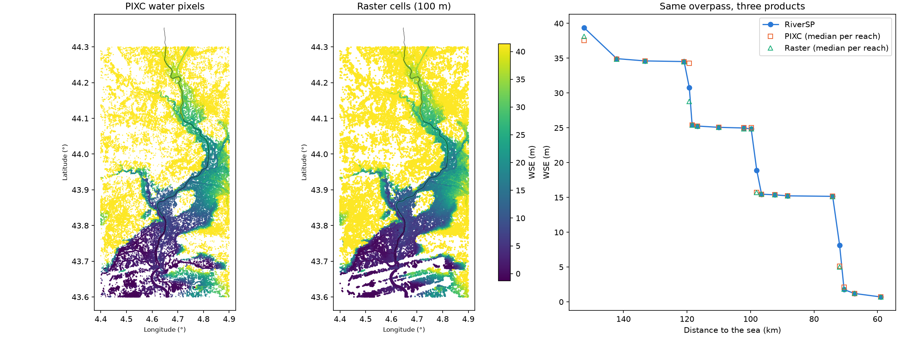
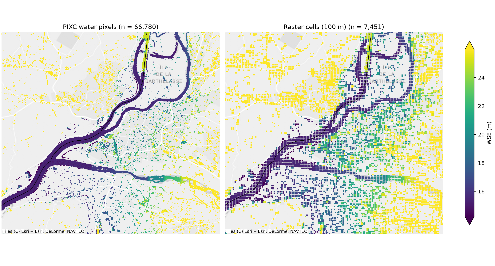

# swot-rhone

Water levels of the lower Rhône from SWOT: quality control, a comparison of the three hydrology
products (PIXC, Raster, RiverSP) for one overpass, and a measured optimisation of data reading.



## Questions

1. How does SWOT see water-level changes along the regulated lower Rhône?
2. For one overpass, how do PIXC, Raster and RiverSP relate and how well do they agree?
3. Where does the workflow spend its time, and how much faster can it be made?

## Study area and data

- **River:** lower Rhône, 20 SWORD reaches (~93 km) from reach 21602300881 (near Bollène) to
  21602100025 (below the last dam, before the split at Arles). The section is defined by SWORD
  reaches and the downstream topology, not by a bounding box.
- **Period:** 2023-07-21 (start of the science orbit) to today.
- **SWOT products (version D), from PO.DAAC with `earthaccess`:**
  - RiverSP Reach: 1,145 files (~6 GB), full period.
  - PIXC: 3 tiles (2.1 GB) and Raster 100 m UTM31T: 2 scenes (117 MB), for one overpass.
- **SWORD:** reach IDs, types, topology and dams, from the RiverSP attributes.

## Workflow

| Script                                                                     | Step                                                                                                                                   |
| -------------------------------------------------------------------------- | -------------------------------------------------------------------------------------------------------------------------------------- |
| `01_search.py`                                                             | Search files and sizes before downloading                                                                                              |
| `02_download.py`                                                           | Download RiverSP Reach files (parallel threads, restartable)                                                                           |
| `03_read.py`                                                               | Read reaches in the bbox, trace the main channel, clean (fill values, empty passes, duplicate processing versions, period from config) |
| `04_explore_flags.py`, `05_qc.py`                                          | Look at flag distributions, then apply flag QC                                                                                         |
| `06_explore_spikes.py`                                                     | Choose the spike threshold from the data                                                                                               |
| `07_figures.py`                                                            | Map, time series, longitudinal profile                                                                                                 |
| `08_choose_overpass.py`, `09_download_overpass.py`                         | Choose the best overpass from QC'd data; download PIXC and Raster                                                                      |
| `10_explore_pixc.py`, `12_read_pixc.py`                                    | Inspect PIXC metadata; read water pixels and compute WSE                                                                               |
| `13_pixc_vs_riversp.py`, `14_explore_raster.py`, `15_raster_vs_riversp.py` | Compare PIXC and Raster with RiverSP, reach by reach                                                                                   |
| `16_figure_products.py`, `17_map_overpass.py`                              | Product comparison figure and zoomed map                                                                                               |
| `18_benchmark.py`                                                          | Benchmark data reading                                                                                                                 |

All parameters (reaches, dates, QC thresholds, overpass, zoom) are in `config/rhone.yaml`.
Reusable functions are in `src/swot_rhone/`. Detailed notes on every dataset and decision are in
`output/docs/`.

## Results

### 1. Quality control

Of 3,892 reach observations, **2,730 (70.1%) are kept**.

| Test         | Threshold                                                           | Removed         |
| ------------ | ------------------------------------------------------------------- | --------------- |
| `reach_q`    | ≤ 1 (90% of data are "suspect"; keeping only "good" would lose 97%) | 276 (7.1%)      |
| `xovr_cal_q` | ≤ 1                                                                 | 125 (3.2%)      |
| `dark_frac`  | ≤ 0.5                                                               | **925 (23.8%)** |
| Spike        | > 3 m from both neighbours (just above the 99th percentile, 2.84 m) | 25 (0.6%)       |

Dark water is the main reason for removal. The largest spikes are almost all on one reach
(21602100045), with values of −3 to −10 m that are physically impossible there.

### 2. A regulated river seen from space



The profile (top) shows three dam steps (~9–13 m) with flat backwater pools in between.
The same flood looks different depending on position: it raises the water at the upstream end
of a pool, it shows up as a _drop_ just upstream of a dam (likely the pool is lowered to pass
the flood), and below the last dam the level follows discharge.

### 3. Three products, one overpass (2024-11-22, pass 292)




- PIXC WSE was computed from the file metadata: height − geoid − solid-earth, load and pole tides
  (the crossover correction is already applied). Raster and RiverSP are already corrected.
- Median WSE per reach (pixels/cells within 300 m of the main channel) agrees with RiverSP to
  **2.7 cm (PIXC)** and **3.2 cm (Raster)**.
- Large differences only at the three reaches that contain a dam: one WSE for a reach with a
  10 m step is ill-defined (on one of them PIXC is 3.5 m above RiverSP, Raster 1.9 m below).
- Only ~22% of the PIXC water pixels in the box are on the main channel; many others follow the
  terrain and are probably land classified as water.

### 4. Optimisation

Reading 1,145 zipped shapefiles (Apple Silicon, 10 cores; two runs, nearly identical times):

| Version                       | Time             | Table memory |
| ----------------------------- | ---------------- | ------------ |
| All columns, sequential       | 20.3 s           | 17.9 MB      |
| Needed columns only           | 19.1 s           | 5.2 MB       |
| Needed columns + 10 processes | **5.2 s (3.9×)** | 5.2 MB       |

The parallel version gives identical rows and values. Reading fewer columns saves memory but
little time, so the cost is in opening files and spatial filtering (CPU-bound).

## Limitations

- One regulated river and one overpass for the product comparison: not a general validation.
- No comparison with gauge stations yet, so QC is judged on internal consistency only.
- Pixel-to-reach assignment is a 300 m spatial approximation (the official one is in PIXCVec).
- The bbox cuts the most upstream reach, which biases its PIXC/Raster median.
- Two impossible values remain after QC; the spike test misses consecutive or edge errors.
- Benchmark timings are from one laptop and are not extrapolated to global processing.

## Next steps

- Compare with gauge stations (Hub'Eau / Hydroportail), with the gauge datum.
- Investigate reach 21602100045 with PIXC/PIXCVec.
- Per-reach outlier test based on distance from the reach median.
- For larger scales: read each file once into partitioned Parquet; process files or basins as
  independent parallel tasks; test on a larger sample.

## Project structure

```
swot-rhone/
├── config/            settings: study reaches, search area, dates
├── data/              downloaded and processed data (not in Git)
│   ├── raw/           original files, never modified
│   ├── interim/       Rhône subsets
│   └── processed/     clean, quality-controlled tables
├── src/               reusable functions
├── scripts/           workflow steps, run in order
├── tests/             tests for the functions
└── output/
    ├── figures/       plots
    ├── tables/        result tables
    ├── benchmarks/    speed and memory measurements
    └── docs/
```

## How to run

```bash
python -m venv .venv && source .venv/bin/activate
pip install -e .
python -c "import earthaccess; earthaccess.login(persist=True)"   # NASA Earthdata account
python scripts/01_search.py      # then run the scripts in order
```
